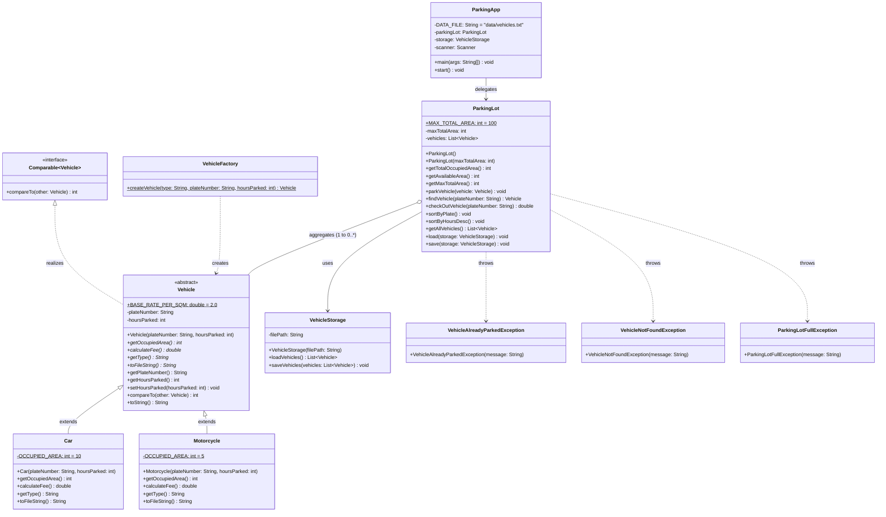

# UML Class Diagram & Architecture

This document describes the Object-Oriented design and structure of the Mini Parking Lot application, including area-based capacity and pricing.

## Mermaid Class Diagram

## Structure Overview
1. **Inheritance & Polymorphism**: `Car` and `Motorcycle` extend abstract `Vehicle`, providing concrete occupied area definitions (`10 m²` and `5 m²`) and area-based fee calculations (`hours * area * BASE_RATE_PER_SQM`).
2. **Capacity Management**: `ParkingLot` tracks total occupied area against `MAX_TOTAL_AREA` (100 m²), throwing `ParkingLotFullException` when capacity is exceeded.
3. **Factory Pattern**: `VehicleFactory` encapsulates instantiation behind `createVehicle(...)`.
4. **Data Persistence**: `VehicleStorage` handles text persistence using `try-with-resources`.
